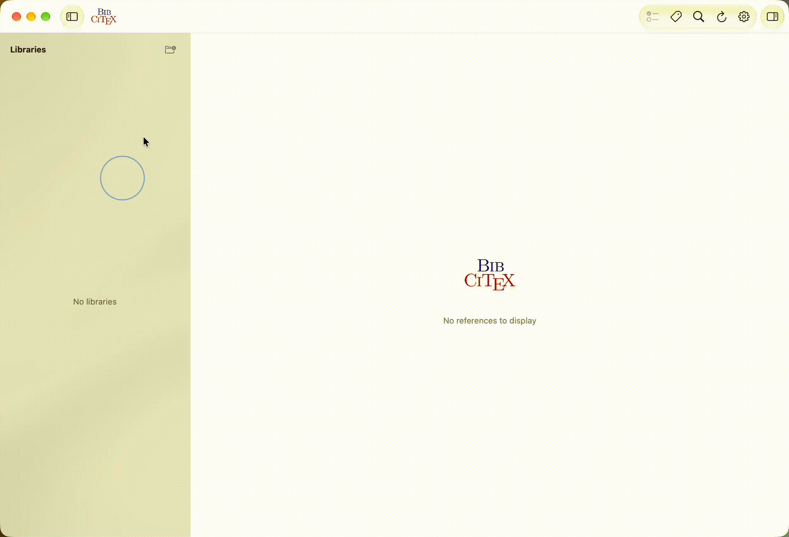
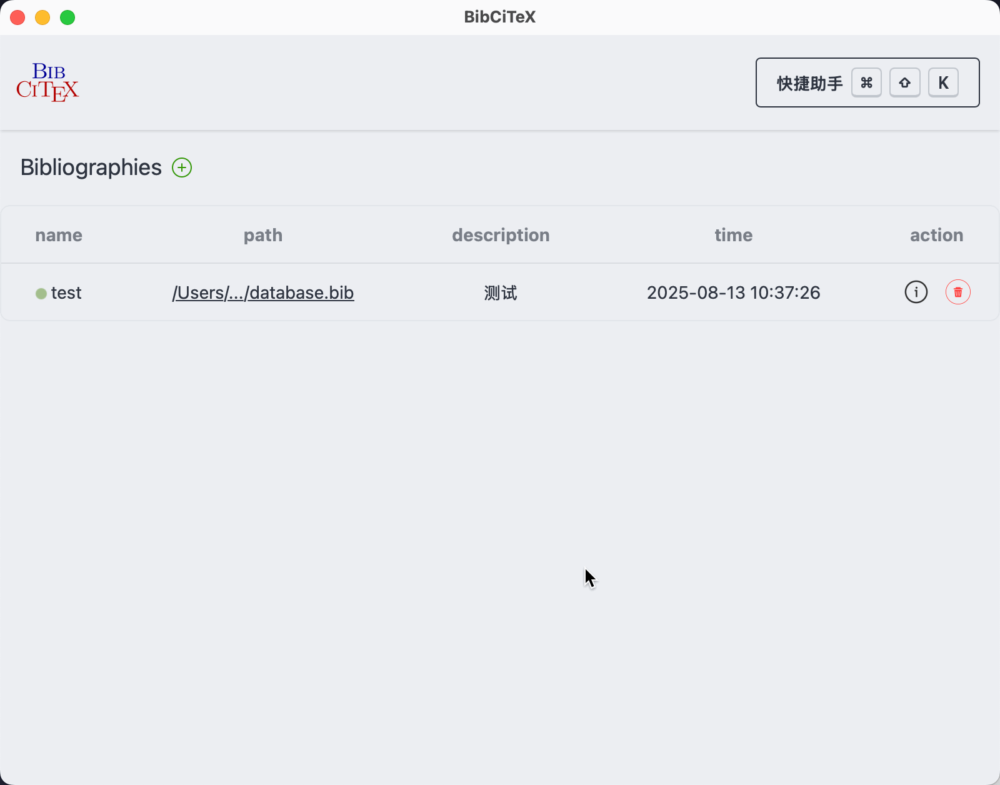
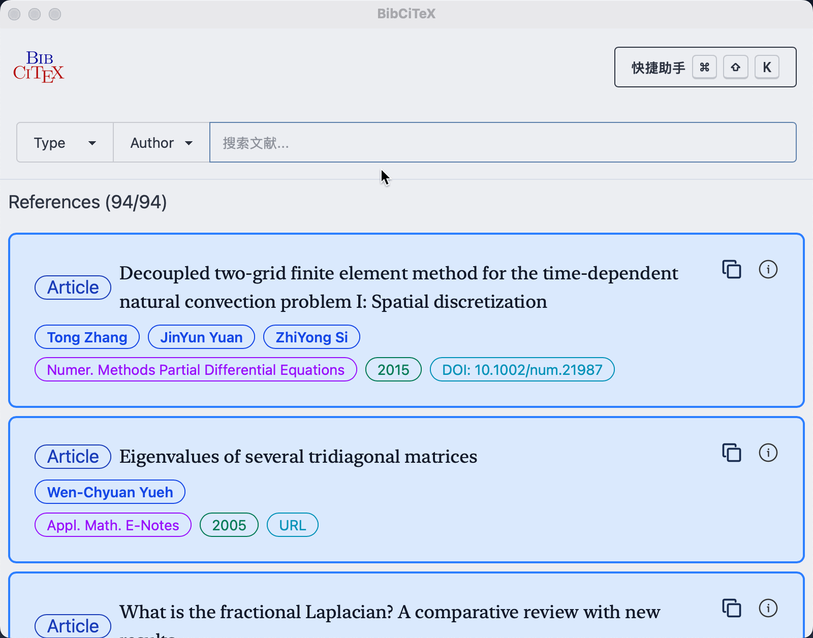
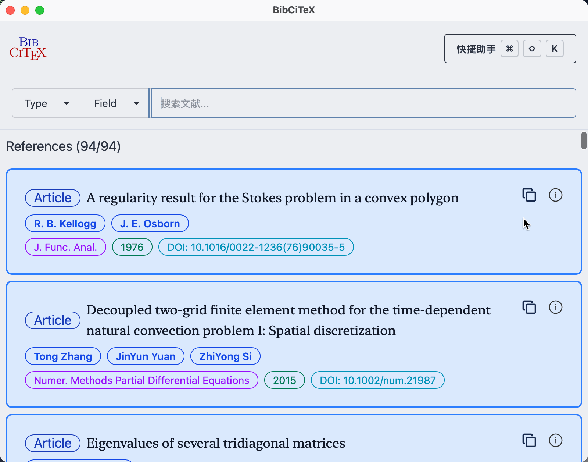
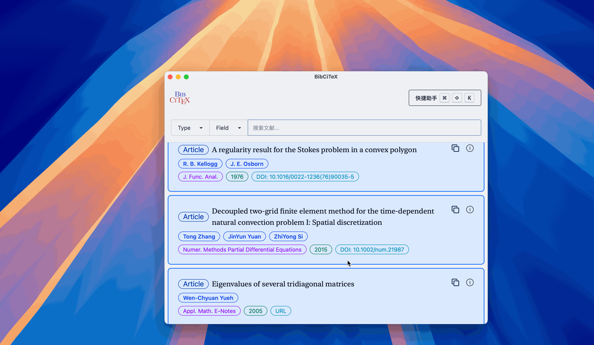
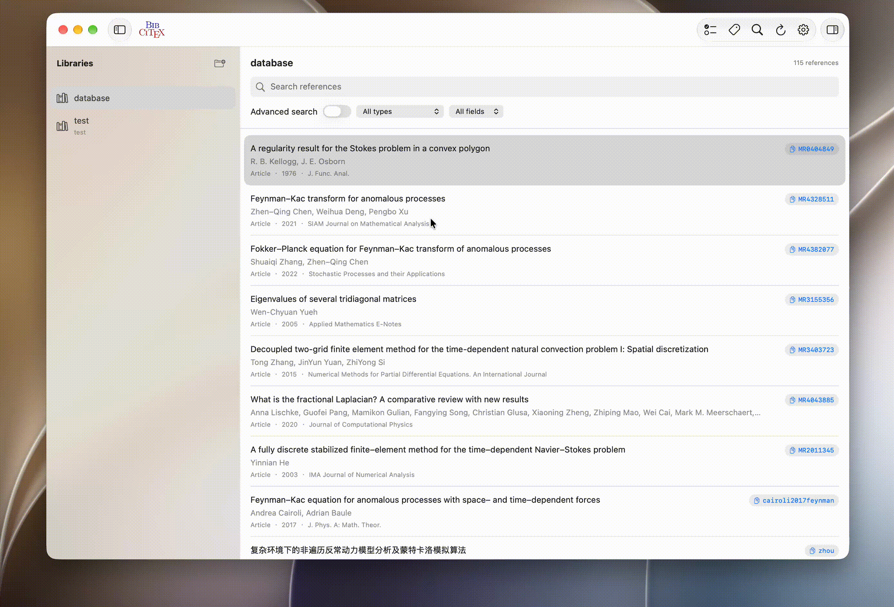
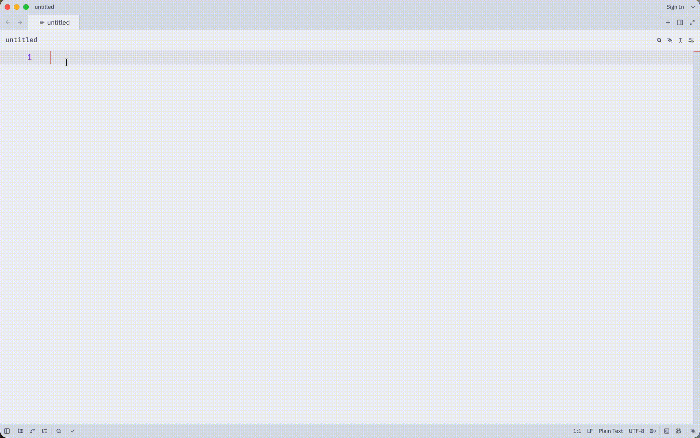

<div align="center">
  

  <p><a href="README.md">English</a> | 简体中文</p>

  <p>
    BibTeX 文献快捷引用工具
  </p>

  <p>
    <a href="https://github.com/tangxiangong/bibcitex/releases">
      
    </a>
    <a href="https://github.com/tangxiangong/bibcitex/blob/main/LICENSE-MIT">
      
    </a>
  </p>

  <p>
    <strong>系统要求</strong>
  </p>

  <p>
    
    
    
  </p>

  <p>
    <strong>快速下载</strong>
  </p>

  <p>
    <a href="https://github.com/tangxiangong/bibcitex/releases/download/v0.8.0/BibCiTeX-0.8.0-macos-arm64.dmg">
      
    </a>
    <a href="https://github.com/tangxiangong/bibcitex/releases/download/v0.8.0/BibCiTeX-0.8.0-macos-x86_64.dmg">
      
    </a>
    <a href="https://github.com/tangxiangong/bibcitex/releases/download/v0.8.0/BibCiTeX-0.8.0-windows-arm64.exe">
      
    </a>
    <a href="https://github.com/tangxiangong/bibcitex/releases/download/v0.8.0/BibCiTeX-0.8.0-windows-x64.exe">
      
    </a>
  </p>
</div>

## 简介

**BibCiTeX** 是一个以 **Rust** 为核心的 **BibTeX** 文献快捷引用工具。

支持 macOS 与 Windows，提供文献搜索、引用复制和跨应用粘贴功能。

v0.8.0 更新内容：[中文发布说明](release-notes/0.8.0/zh-Hans.md) · [English release notes](release-notes/0.8.0/en.md)。

### 核心特性

- **一键复制**: 便捷的引用复制功能
- **跨应用粘贴**: 无缝集成到您的工作流程

## 安装指南

### **下载**

从 [**Release 页面**](https://github.com/tangxiangong/bibcitex/releases) 下载对应平台架构的最新版本安装包。

### macOS 安装说明

也可以通过项目维护的 [Homebrew tap](https://github.com/tangxiangong/homebrew-tap) 安装，支持 macOS 13 及以上的 Apple Silicon 和 Intel Mac：

```bash
brew install --cask tangxiangong/tap/bibcitex
```

应用支持内置更新。如需通过 Homebrew 更新，执行 `brew update` 后运行 `brew upgrade --cask --greedy bibcitex`。

若提示 `BibCiTeX` 已损坏，请打开终端执行以下命令：

```bash
sudo xattr -dr com.apple.quarantine /Applications/BibCiTeX.app
```

> **提示**: 这是由于 macOS 的安全机制导致的，执行上述命令后即可正常使用。

## 界面功能预览

以下动图来自历史版本。

<div align="center">

### 核心功能展示

|                          添加 `.bib` 文件                          |                                   文献列表                                   |                             智能搜索                             |
| :----------------------------------------------------------------: | :--------------------------------------------------------------------------: | :--------------------------------------------------------------: |
| [](./assets/add_bib.gif) | [](./assets/show_details.gif) | [](./assets/search.gif) |
|                       *快速导入 BibTeX 文件*                       |                              *查看文献详细信息*                              |                          *实时搜索过滤*                          |

|                             侧边详情                             |                          外部链接                          |                           复制引用                           |
| :--------------------------------------------------------------: | :--------------------------------------------------------: | :----------------------------------------------------------: |
| [](./assets/drawer.gif) | [](./assets/url.gif) | [](./assets/copy.gif) |
|                         *侧边栏详情展示*                         |                     *快速访问外部资源*                     |                      *一键复制引用格式*                      |

### 特色功能

<div style="margin: 20px 0;">
  <h4>跨应用粘贴</h4>
  <a href="assets/cross_paste.gif">
    
  </a>
  <p><em>无缝集成到您的工作流程，支持跨应用程序粘贴功能</em></p>
</div>

</div>

## 高级搜索使用方法

macOS、Windows 和 Linux 共用 Rust 高级搜索引擎，词法和语法解析明确使用 **chumsky**。主窗口与托盘窗口分别打开“高级搜索”开关；两处开关默认关闭、分别保存，普通与高级模式保留各自草稿。Helper 默认使用高级搜索。普通模式不会把 `author:`、`OR` 等解释为高级语法。

### 快速开始

在高级搜索输入框直接输入查询，也可以打开条件编辑器添加条件、AND/OR 分组和排除条件；两种方式使用同一查询规则。

| 想找什么                                 | 输入示例                          |
| ---------------------------------------- | --------------------------------- |
| 同时包含两个关键词，可出现在不同默认字段 | `graph network`                   |
| 连续短语                                 | `"machine learning"`              |
| 作者与年份同时满足                       | `author:Knuth year:>=2020`        |
| 标题包含一个词，排除另一个词             | `title:graph -survey`             |
| 二选一，再限定作者                       | `(graph OR network) author:Smith` |
| 期刊论文或书籍                           | `type:(article OR book)`          |
| 2020–2024 年，包含两端                   | `year:2020..2024`                 |
| 同时具有两个标签                         | `tag:待读 tag:数学`               |
| 任一标签，并排除已读                     | `tag:(数学 OR 算法) -tag:已读`    |
| 完整引用键                               | `key:Smith2024`                   |

空格表示 AND；也可以显式写 `AND`。只有大写 `AND`、`OR`、`NOT` 是布尔运算符，小写按普通文本处理。优先级为括号 → `NOT` / `-` → AND → OR。`graph OR network author:Smith` 等价于 `graph OR (network AND author:Smith)`；要让作者限制两边，使用表中的括号写法。`NOT survey` 与 `-survey` 等价，减号后不能有空格。只含排除条件也可以搜索。文献库及外部筛选仍约束整个表达式。

### 字段、短语和标识符

字段名不区分大小写，冒号后必须紧接值或左括号：`author:Knuth` 正确，`author: Knuth` 错误。字段名使用下表中的英文语法名；多词短语使用 ASCII 双引号。

| 字段                                                 | 搜索内容                                                          |
| ---------------------------------------------------- | ----------------------------------------------------------------- |
| `title`（别名 `intitle`）                            | 标题                                                              |
| `author`、`editor`                                   | 作者、编者；每个条件可匹配列表中的任一人                          |
| `journal`                                            | 期刊简称或全称                                                    |
| `booktitle`                                          | 所属书籍、文集或会议录标题                                        |
| `abstract`、`note`                                   | 摘要、备注                                                        |
| `publisher`、`school`、`institution`、`organization` | 出版者、学校、机构、组织                                          |
| `key`（别名 `citekey`）                              | 完整引用键，忽略大小写，不忽略重音和标点                          |
| `doi`                                                | 完整 DOI，忽略大小写及常见 DOI URL / `doi:` 前缀                  |
| `isbn`                                               | 完整 ISBN，忽略空白和 ASCII 连字符，不自动等同 ISBN-10 与 ISBN-13 |
| `year`                                               | 年份、比较或范围                                                  |
| `type`                                               | 文献类型                                                          |
| `tag`                                                | 完整标签名                                                        |

未指定字段时，搜索当前默认范围内的引用键、标题、作者、期刊、年份和备注；摘要等扩展字段需要显式指定。`title:graph neural` 只限制 graph 的字段；`title:(graph neural)` 将两个词都限制在标题。组内显式字段覆盖继承范围，例如 `title:(graph OR author:Smith)`。`author:Smith author:Jones` 可以分别匹配两位作者，`author:"Smith Jones"` 必须在同一位作者内连续出现。

未加引号的文本支持大小写、重音及常见标点容错，以及前缀/子串匹配。双引号表示连续短语：忽略大小写和连续空白的差异，但保留重音、标点、数学符号及词边界，不能跨字段或跨两位作者匹配。`"machine learning"` 不匹配 `machine deep learning` 或 `machine learnings`。DOI、ISBN、引用键、年份、类型和标签即使加引号，仍按各自字段规则匹配。

只有未限定字段的正向普通词可能使用拼写补充；正常结果少于 20 条时，标题、作者、期刊内 5–64 个拉丁字母的词可容许一次拼写差异。显式字段、短语、标识符、年份、类型、标签和否定条件不纠错；同一匹配条件在查询中被否定时也不纠错。正常命中排在补充命中前，界面标明纠错词。

### 年份与类型

| 写法                           | 含义                   |
| ------------------------------ | ---------------------- |
| `year:2026` 或 `year:=2026`    | 等于 2026              |
| `year:>2020` 或 `after:2020`   | 晚于 2020，不含 2020   |
| `year:<2024` 或 `before:2024`  | 早于 2024，不含 2024   |
| `year:>=2020` 或 `year:2020..` | 2020 及以后            |
| `year:<=2024` 或 `year:..2024` | 2024 及以前            |
| `year:2020..2024`              | 2020 到 2024，包含两端 |

年份为 1–9999 的整数；范围不能倒置，比较符和值之间不能有空格。`before` / `after` 只接受单个年份，指文献年份。没有年份的文献不满足正向年份条件，但可满足该条件的否定。裸 `2020..2024` 是普通文本。

类型值忽略大小写，支持 `article`、`book`、`thesis`、`mastersthesis`、`phdthesis`、`booklet`、`inbook`、`incollection`、`inproceedings`、`misc`、`techreport`。`thesis` 包含一般、硕士和博士论文。`type:article type:book` 要求同时属于两类，结果为空；多选类型用 OR。Manual、Proceedings、Unpublished 的文献支持仍不完整。

### 标签

主窗口和托盘支持 ⌘（Windows/Linux 为 Ctrl）点选增减、Shift 范围选择、⌘/Ctrl+A 全选及 Shift+方向键扩选。快捷键只作用于当前焦点：搜索框中的全选仍选择文字。Helper 普通点击直接粘贴；⌘/Ctrl 点选增减选择，Shift 点选或 Shift+方向键范围选择，⌘/Ctrl+A 全选当前结果（搜索框聚焦时也生效）。回车按列表顺序将所选 cite key 以逗号连接后粘贴。Helper 不显示多选按钮，多选只用于粘贴。

主窗口和托盘可通过“多选”勾选当前结果，再从“已选 N”菜单进入“批量标签”；菜单也提供全选、清空和结束多选。批量编辑区分全部已添加、部分已添加和未添加，支持添加到全部、从全部移除，以及创建并添加。搜索、筛选、库切换或结果刷新会清空选择；已打开的批量编辑器固定所选 UUID。写入会校验全部目标和元数据修订，失败时不会只修改部分文献。

文献列表直接显示彩色标签。点击标签或文献的标签入口，即可搜索、勾选添加/移除，或一步创建并添加标签。标签菜单支持改名、改色；全局管理提供合并、删除和失效标签关联恢复；没有失效关联时隐藏恢复入口。重新定位文件请在文献库管理中编辑文献库，点击“重新定位来源”，选择新文件后保存。

文献库、文献记录和标签的 UUID 就是各自的 UID。库改名或重新定位时 UUID 保持不变，即使文件内容同时改变。全局标签可跨库使用，关联只保存 UUID，不保存 `.bib` 路径，也不改写 `.bib` 文件。备份时同时保留配置目录中的 `setting.json`（UUID 与文件位置）和 `search-metadata.json`（标签与文献关联）。已有文献库注册信息在首次使用时分配 UUID；普通 BibTeX 导入导出不携带标签。

标签按完整名称匹配，忽略大小写并规范化空白，保留重音和标点；含空格时写 `tag:"machine learning"`。未知标签匹配零条，`-tag:未知标签` 不排除任何文献，并给出未知标签提示，不自动创建标签。

从候选或条件编辑器选中的标签绑定稳定 ID，改名后仍跟随原标签；手写 `tag:旧名称` 按名称查询，不自动跟随改名。已选标签被删除时需要移除或重新选择条件，不会静默放宽搜索。无法可靠识别的文献变更保留为失效标签关联，可在标签管理中手动重新关联。

### Helper：悬浮候选与胶囊

1. 在尾部空白边界直接键入 `@`（类型）、`$`（字段）或 `#`（已有标签）。立即出现栏内小输入框和悬浮候选列表。
2. 第一个小输入框**只筛选候选名称**。例如输入 `$` 后输入“作者”，只显示作者字段；输入 `@` 后输入“书籍”，筛选书籍类型。中文界面也接受对应英文名称和语法名；英文界面只使用英文名称和语法名。自定义标签按原名筛选。
3. 用上下键选择，Enter 或点击确认。类型和标签直接变成胶囊，不需要填写值，光标回到胶囊后。
4. 字段选中后出现**另一个可选值框**：选择 `year`，输入 `2026` 后 Enter，生成 `year:2026` 条件，并恢复之前的关键词范围。留空 Enter、Tab 或 Esc 跳过值输入，只保留所选字段作为关键词范围。例如选择 author 后跳过值，再在尾部输入 Knuth，即在作者中搜索。已有显式字段、类型和标签不受这个默认范围覆盖。
5. 确认后按有效条件更新结果，可以继续输入关键词或添加胶囊。尾框光标在开头且无选区时，Backspace 删除前一个胶囊并同步移除条件，可连续删除；有文字、选区或中文组合时优先执行原生删除。

Esc 取消候选并恢复触发前草稿。候选列表悬浮在小输入框附近，最多显示六行后滚动，不占下方结果区域，没有“取消 / 标签管理”底部按钮。中文输入法选字期间，方向键、Enter 和 Esc 先交给输入法；确认中文的同一次 Enter 不会同时选择条件或粘贴结果。候选筛选框与可选值框中的删除键只编辑自身文本。

触发符必须真实键入；粘贴、程序更新、邮箱、`C#`、公式和已有词中的符号不会启动候选。Helper 没有关键词和有效条件时保持紧凑空闲状态；只有字段范围胶囊也不会加载整个文献库。

### 字面符号与输入错误

`graph-based`、`C++`、`C#` 是普通文本。用 `"AND"`、`"-survey"`、`"title:graph"`、`"f(x)"` 搜索字面内容。引号内 `\"` 表示双引号，`\\` 表示反斜杠；引号外可用 `\(`、`\)`、`\"`、`\\`、`\:` 和条件开头的 `\-` 转义结构字符，其他反斜杠序列保留。未知前缀如 `abc:def`、URL 按普通文本处理，拼错的 `titel:graph` 不会自动变成 `title:graph`。这不是 Google 网页搜索，不支持 `site:`、`filetype:` 等网页运算符。

`author:`、未闭合引号/括号、末尾 `OR` 属于未完成输入；`author: Knuth`、空引号、空括号、倒置年份范围属于错误。存在确定错误时优先报错。未完成或错误查询不执行，也不允许对旧结果继续复制/粘贴，补全或修正后恢复。

## TODO

详细待办见 [TODO.md](./TODO.md)。

- [x] **普通搜索增强**：多关键词、模糊匹配、相关性排序与性能优化。
- [x] **高级搜索**：使用 chumsky，支持字段、短语、布尔分组、排除、年份范围和可视化条件编辑。
- [x] **Tag 功能**：单篇标签分配、目录管理、稳定身份与标签筛选。
- [x] **批量标签**：三端多选、混合状态展示与原子添加/移除。
- [x] **Helper 筛选指令**：三端悬浮 `@ / $ / #` 候选、栏内名称筛选、可选字段值与可删除胶囊。
- [ ] **多选完善**：批量复制和输出格式预设待实现；Helper 已支持逗号连接的批量粘贴。
- [ ] **复制与粘贴格式**：支持裸 cite key、LaTeX 和 Typst 引用预设，以及多篇引用组合。

## 第三方代码版权声明

### [crates/xpaste](./crates/xpaste)
- **来源**: [EcoPasteHub/EcoPaste](https://github.com/EcoPasteHub/EcoPaste)
- **作者**: EcoPasteHub
- **许可协议**: [Apache 2.0](https://github.com/EcoPasteHub/EcoPaste/blob/master/LICENSE)
- **用途**: 实现跨应用的粘贴功能
- **版权声明**:
  ```
  Copyright (c) EcoPasteHub
  ```
- **主要修改**:
  -  macOS: 将过时的 `objc` 和 `cocoa` 替换为 `objc2` 相关的 API
  - Windows: 将过时的 `winapi` 替换为 `windows-sys` 相关的 API

---

> **详细信息**: 完整的归属信息请参阅 [**NOTICE**](./NOTICE) 文件

## 许可协议

本项目采用双重许可协议，您可以选择其中任意一种：

* **Apache License, Version 2.0** ([LICENSE-APACHE](LICENSE-APACHE) 或 https://www.apache.org/licenses/LICENSE-2.0)
* **MIT License** ([LICENSE-MIT](LICENSE-MIT) 或 https://opensource.org/licenses/MIT)

### 贡献声明
除非您明确声明，否则根据 Apache-2.0 许可协议的定义，您有意提交的任何贡献都将按照上述双重许可协议进行许可，不附加任何额外条款或条件。
